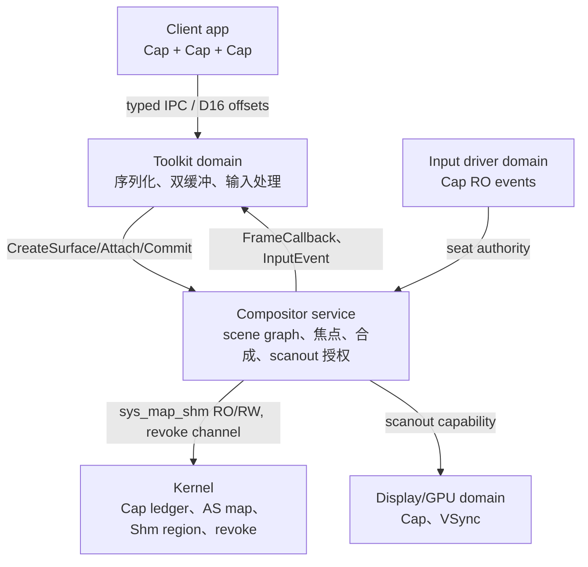
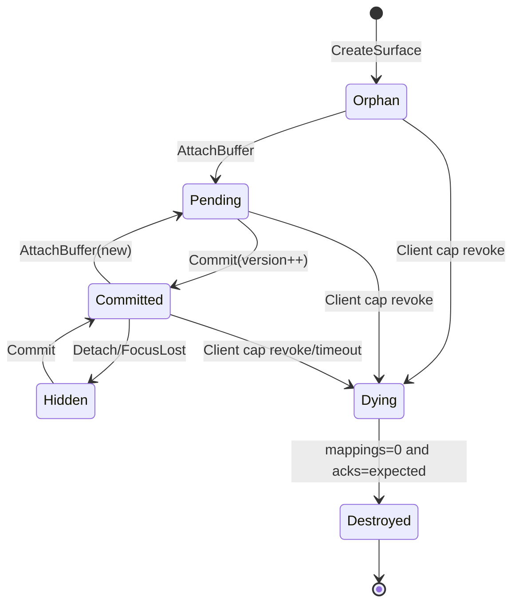

# jhyy 微内核 GUI 子系统：基于 Cap\<T\> 的 Wayland-style Compositor 架构设计

## 摘要：GUI 安全边界应由线性 Cap 与内核共享映射共同承载

**建议采用“线性句柄 + 内核共享映射”作为 jhyy GUI 的基础模型（方案 c）。** 在该模型中，`Cap<Shm>` 作为唯一、可移动的访问凭证，遵循 jhyy 的线性语义；真正支持 client 与 compositor 并发访问的，是内核维护的只读映射集合，而不是某个可被复制的 `SharedCap`。写权限仅在 creator 域中保留，共享端默认收缩为 `RO`，任何 `RW` 派生都必须由 `unsafe_share` 显式承认。这样的分层既保留 Cap 的可撤销性与最小权限，也避免以 GC 式引用计数支撑共享内存生命周期。[1][5]

GUI 安全的核心不在“禁止共享”，而在对共享路径实施可追溯、可撤销的权限控制。seL4 将能力视为由对象引用和权限集合组成的第一类内核对象，并通过 CNode/CSpace 存储；Nitpicker 则将设备垄断、按域隔离和按焦点交付输入事件作为独立窗口系统的安全底线。[1][2] jhyy 应继承这些底层原则，但不应直接移植 Linux 的用户态机制。

架构上，硬件独占必须由 compositor 服务或受它控制的驱动域持有；Wayland 仅作为协议和状态机蓝本。Client 负责渲染；compositor 负责授权、场景、合成和 scanout；内核负责 Cap 派生、地址空间映射、确定性 ID 与 revoke 传播。只有把这三层边界分开，线性 Cap 模型、共享缓冲区和窗口系统安全策略才不会相互侵蚀。

本设计明确区分两类内容：

- **已锁决策**：沿用项目现有 Cap 原则、8 字节 cnode 引用抽象、混合内存模型，以及“compositor 为独立用户态服务、暂定 Wayland-style + capability 增强”的总体路线。
- **建议性设计**：除特别标注外，本文提出的类型语法、权限位、消息编号、状态字段、性能参数和排期均为设计建议，需作者依据 v3.x 路线图确认。

协议编码以 D16 cap-offset 表为核心，消息中的 Cap 不携带裸地址，只承载可审计的偏移索引。`Surface` 的所有权及输入焦点通过线性 `Cap<Surface>` 移动传递；buffer 通过显式 attach/release 与 per-commit 版本号完成借用式交接。异步 revoke 则通过“逻辑失效、映射保护、显式确认、资源回收”四阶段关闭窗口，防止客户端死亡、撤销传播延迟或 compositor 并发扫描导致幽灵 surface。[1][3]

据此，M8d 不能直接进入协议功能扩张，而应在 sprint **3g（Cap/ID ledger）**、**3i（Shm 内核对象）**、**3j（revoke/映射/VSync）** 之后实施；M12 则从“工具包功能集”重定义为“策略合规后的安全 API 稳定集”。所有行数、周数和性能数字均为推断，不是项目实测数据。

## 1. 现有约束已排除直接复制 Cap 与直接共享地址两种极端

**jhyy 现有 Cap 原则支持受控共享，但不足以直接表达 SHM 并发访问。** 设计不能把 Cap 的不可复制性理解为“任何资源最多只能有一个持有者”，而应将唯一访问凭证与多域只读映射拆成两个层次。

题设已锁定：跨域访问一律通过 capability，禁止裸地址；Cap\<T\> 具有类型参数化、不可伪造、move-only、降级需 `unsafe_cap`、撤销由内核负责、`is_valid()`、use-count 追踪，以及跨 IPC 的 D16 cap-offset 改写等规则。其 layout/ABI 固定为 8 字节 cnode 引用。这是 GUI 可以依赖的最小语义基线。

Wayland 的设计提供了互补的协议约束：client 自行渲染，再将 buffer 与更新告知 compositor，因此 buffer 管理主要由应用控制；如果应用直接与 compositor 共享的 buffer 竞争写入，则可能出现空白或半渲染内容。[3] 这表明 GUI 需要显式所有权阶段，而不是把共享映射本身当作同步机制。jhyy 可以利用这一蓝本，但不能把 Linux 的 fd、mmap、evdev 或 DMA-BUF 假设带进内核契约。

| 约束 | 可直接推出的规则 | 不可推出的结论 | 本报告的取舍 |
|---|---|---|---|
| Cap 不可伪造、由内核撤销 | 内核必须能够定位映射与持有者 | 内核必须对所有像素操作做仲裁 | 撤销对象，不仲裁每次访问 |
| Cap 是 move-only | `Cap<Surface>`、`Cap<Compositor>` 不实现 `copy` | `Cap<Shm>` 不能跨域存在 | Shm 采用内核共享映射，句柄仍线性 |
| `unsafe_cap` 降级 | `RW→RO` 是权限收缩 | 只读自动安全 | 仅 `unsafe_share` 允许 RW 派生 |
| `unsafe_share` 预留 | 项目已承认存在受审计例外 | 默认开启共享 | 默认 RO；RW 必须显式标注 |
| D16 cap-offset | 消息中 Cap 使用稳定索引 | 偏移可由 sender 自行选择 | 采用三账本 + canonical offset |

**Cap 的唯一性应约束“谁能够改变映射或提交状态”，而不是约束物理页的映射数量。** 换言之，`Cap<Shm>` 与 SHM region 不是同一对象：`Cap<Shm>` 是线性句柄，region 是由内核对象管理的页集合。多个只读映射可以由同一个 region 派生，但每个映射均应有独立审计记录。

这种设计满足题设中的“线性↔共享冲突”，且不违反 region type、线性 Cap 或 `unsafe_share` 原则。若坚持句柄绝对唯一、页表也只能单映射，则 client/compositor 架构将退化成逐帧拷贝；若反过来允许 Cap 默认复制，则 use-count、revoke 和 capability 派生链都会失去明确根节点。因此，真正的解法是**句柄线性、映射共享、权限收敛**三者共同成立。

**确定性不是消息格式附属要求，而是 Cap IPC 正确性的组成部分。** 若不同 build 目录或并行度产生不同的 D16 cap-offset，byte-equal 自举闭环、重放测试和内核对象解析都可能失效。建议由 CapId、msg_tag 和 CapOffsetTable 组成三张 ID ledger：

1. CapId 全局唯一，并在对象整个生命周期中保持稳定；
2. msg_tag 标识消息类型、版本和参数 schema；
3. CapOffsetTable 仅保存规范化后的 D16 偏移，并保证同一能力在同一消息中复用同一偏移。

序列化步骤应当是确定性的，包括固定字段顺序、枚举表示、列表长度前缀、禁止指针混入、禁止哈希顺序依赖，以及隔离并发生成器。Reproducible Builds 的定义要求相同源码、构建指令和构建环境产生相同产物；jhyy 还应进一步要求“相同协议源码产生相同 wire 解释”。[6] 这意味着协议编译器本身必须进入可信基，而不能被视为普通应用库。

## 2. 三层架构必须分别承担凭证、策略与映射责任

**安全边界应按“凭证在用户态流转、策略在 compositor 执行、映射在内核审计”划分。** 如果任意一层同时掌握共享、焦点和硬件权限，最小权限原则就会被合并到单一可信组件中，既扩大攻击面，也增加后续验证成本。


*图 1：方案 c 的三层边界。共享发生在内核页表，Cap\<Shm\> 在用户态仍保持线性。数据来源：本研究基于项目背景与 seL4、Genode、Fuchsia、Wayland 资料的设计综合 [1][2][4][5]。*



**Client/toolkit 层不应保存裸帧缓冲地址，也不应直接打开输入设备。** 该层只持有引导阶段由 init 或 compositor 授予的 `Cap<Compositor>`，并通过它创建 surface。初始设计建议为：

- `Cap<Surface>`：move-only；
- `Cap<Buffer>`：在 attach 期间逻辑借用，提交后客户端不得继续写入；
- `Cap<Shm>`：默认仅 creator 持有 RW，compositor 获得 RO mapping。

客户端直接绘制当前 scanout buffer 会与 compositor 的读取形成竞争，可能产生闪烁。[3] 因此，toolkit 必须维护双缓冲或显式 release fence，并通过 commit 移交“该帧已完整”的可见性。drawing 与 commit 是两个不同动作：前者填充像素，后者才允许 compositor 观察新内容。

**Compositor 是最小权限策略决策点，而不是内核图形模块。** 它独占 scene graph、surface 状态、焦点计算、scanout 选择和 `Cap<Seat>` 事件分发；普通 client 不能通过 capability 越级访问。Nitpicker 的核心做法正是由单一窗口服务独占硬件，并把各 client 置于相互隔离的域中，仅向拥有焦点的应用交付输入。[2]

jhyy 不必复刻 Nitpicker 的标签与浮窗细节，但应继承三条底线：

1. 显示器、scanout 和 seat 不向普通 client 暴露原始句柄；
2. 输入事件严格按焦点路由；
3. 全局装饰、权限提示和资源策略均由 compositor 统一实施。

这些职责构成窗口系统的可信计算基。若允许任意 client 直接绑定 seat 或 framebuffer，即使 Cap 类型本身正确，也无法阻止按键窃取和跨应用像素访问。

**内核层只负责抽象对象和可审计映射，不应理解窗口语义。** 必要原语包括：

- `shm_create(region, perms)`：创建 SHM region 及其 capability root；
- `shm_derive(src_cap, rights, flags)`：派生线性 child Cap；
- `shm_map(cap, as, flags)`：在指定地址空间建立映射；
- `unmap(range, epoch)`：撤销特定映射；
- `cap_revoke_async(id, mode)`：进入 revoke 协议；
- `cap_ack_revoke(id, epoch)`：确认回收；
- `seat_bind/compositor_grant`：输入与输出授权。

seL4 中，capability 是“对象引用 + 权限集合”，CSpace 由 CNode 层次结构表示，调用方通过本地 capability index 调用内核对象。[1] jhyy 可以吸收这一模型，但 SHM 页的共享映射应作为独立的内核对象关系存在，不能只靠 Cap 表项复制。

## 3. Cap\<Shm\> 应采用“线性句柄、共享映射、默认只读”的组合语义

**三种共享方案的关键差异，在于 Cap 唯一性、物理共享、回收追踪和权限收敛分别落在哪一层。** 综合兼容性与审计成本，方案 c 明显优于“默认共享 Cap”和“完全依赖 `unsafe_share`”两种路线。

| 维度 | a：`unsafe_share` 显式标注 | b：`SharedCap<T>`（copyable、收缩权限） | c：线性 Cap + 内核共享映射（推荐） |
|---|---|---|---|
| 与 linear Cap 兼容性 | 中：将共享当作豁免，易扩大至非 Shm 类型 | 低至中：引入与 Cap\<T\> 并列的复制物种 | 高：Cap 实例仍唯一，共享仅发生在映射层 |
| 与 region types 兼容性 | 中：需防止共享区域逃逸 | 中：copy 使 region ownership 推理复杂 | 高：region 可关联唯一 owner，映射记录访客 |
| revoke 语义 | 依赖持有者主动归还，难枚举 | 引用计数或 GC 式追踪，与项目排斥 GC 冲突 | 内核以 region→mapping 表精确撤销 |
| 8 字节 ABI 影响 | 小，但语义边界模糊 | 需区分 Owned/Shared repr，增加类型组合 | 句柄保持 8 字节；映射元数据保存在内核 |
| 幽灵 surface 风险 | 高：复制副本可能在撤销后残留 | 中：RC 弱引用可延缓回收 | 低：epoch + page-table unmap + ack |
| 推荐度 | 仅作受限逃生口 | 不推荐为核心 | **核心方案** |

**方案 a 的问题不在于存在 `unsafe_share`，而在于让它承担整个 SHM 模型。** `unsafe_share` 适合明确承认少数量、局部可信的例外，例如由 compositor 授权 GPU 域写入 scanout。如果 `Cap<Shm>` 默认通过它变成可复制对象，就会与“Cap 不可伪造、use-count 追踪、撤销由内核负责”发生冲突。内核若只保存 Cap 表而不保存映射表，也无法确定某次撤销后是否仍有存活映射。

因此，建议保留 `unsafe_share`，但只作为“显式承认跨域可写别名”的权限降级标注，不用于普通 client/compositor 像素共享。其语义应限制为：`unsafe_cap RW→RW shared(S)`。编译器必须检查 `S` 的作用域、封送边界和审计日志；封送时必须同时传递 region ID、权限和 epoch。该方法可以支撑高性能 GPU 协作，却不适合承担日常窗口缓冲区，否则安全例外会成为默认路径。

**方案 b 把共享对象本身建模为 `SharedCap<T>`，表面符合类型系统，实质上会把回收职责推回语言运行时。** 如果 `SharedCap<Shm>` 可复制，强引用计数就会与项目已排斥的 GC 式引用计数形成冲突。弱引用可避免延长对象生命周期，但无法阻止撤销传播期间产生悬空强引用；若依赖析构器扫描，又会重新引入 GC 语义。

Fuchsia 的强类型 FIDL 事务和 handle 转移可用于类比，但不能据此推出 Cap 应默认可复制。Fuchsia 组件模型建立在 Zircon capability 与 FIDL 的 handle 转移之上，View/ViewHolder 的令牌语义仍需单独建模。[4] 因此，类型层可引入只读投影 `Borrow<Shm, RO>` 或 `ShmMapping` 作为**非 Cap 值**，但不能让 `SharedCap<T>` 成为与线性 Cap 并列的通用物种。

**方案 c 同时满足“句柄唯一、物理共享、内核精确回收”。** 其对象模型为：

- `Region`：内核 SHM 对象，记录 owner、size、layout、epoch、访客映射列表和可选 GPU handle；
- `Cap<Shm>`：线性 capability root，可以派生权限收缩的 child；
- `Mapping`：region、address space、range、rights 和 epoch 五元组；
- `Epoch`：64 位单调递增逻辑时钟。

Client 拥有 `Cap<Shm, RW>` 时，可以通过 `shm_map` 在自身地址空间写入；compositor 只获得 `Cap<Shm, RO>`。两者看到同一物理页，但 capability 图不发生复制。若需 GPU 写入，必须由 `unsafe_share` 从 RW owner 派生单独的 W 或 RW 映射，并由 compositor 明确追踪 fence。

回收流程必须遵循“逻辑失效—映射保护—显式确认—资源释放”的顺序：

1. client 死亡，或调用 `cap_revoke_async(region_id, mode)`；
2. 内核递增 epoch，并将 region 标记为 logically dead；
3. 内核立即失效相关页表项，必要时使用 shootdown/IPI；
4. compositor 收到 `RevokeBegin(region_id, epoch)`；
5. compositor 停止引用并发送 `AckRevoke(epoch)`；
6. 当所有映射和 in-flight 提交均确认后，内核释放物理页。

此流程可避免“对象删除但映射仍可读写”的窗口。对于 scanout 中正在使用的缓冲区，可先执行 epoch 切换，并等待当前 VSync 边界再回收，但必须限制最长宽限期，防止恶意客户端以正在显示为由永久占用资源。

**buffer 的所有权应通过 commit/return 协议交接，而不是依赖单一 Cap 状态。** 推荐三种状态：

- `ClientOwns`：客户端可以写入；
- `CompositorBorrowed`：已 attach，仅 compositor 读取；
- `Released`：已返还，可再次写入。

在 `AttachBuffer` 时，client 将 `Cap<Buffer>` 及其 RO 权限随 IPC 移动或借用；在 commit 后，toolkit 必须将本地访问封装标记为不可用。只有在 compositor 发送 `BufferReleased` 后，客户端才能恢复写入。如果 compositor 仍保留旧 buffer，revoke epoch 会保证它不再访问被回收 region。这一规则同时覆盖了双缓冲和单缓冲：前者通过多个 buffer 轮换，后者通过 attach/release 串行化。

## 4. Surface 生命周期必须由状态、版本和撤销阶段共同封闭

**`Surface` 应采用线性所有权链，而 scene node 由 compositor 内部记账。** 二者不能混为一谈：前者决定谁有权修改窗口对象，后者记录 compositor 的场景拓扑。只有将 Cap 所有权与场景引用分开，才能避免“client 死亡后节点立即消失”或“节点残留导致幽灵 surface”两类错误。

建议状态包括：

- `Orphan`：已创建，但尚未绑定 client root；
- `Pending`：已 attach，等待 commit；
- `Committed`：参与合成；
- `Hidden`：已 detached 或失去可见性；
- `Dying`：client 已失效，等待资源回收；
- `Destroyed`：所有映射和引用均已完成回收。

`Cap<Surface>` 从 compositor 移交给 client 后，client 负责 `commit`、`attach` 和 `destroy`；compositor 只在本地保存不带 Cap 所有权的 `SurfaceNode`。Client 死亡时，内核 revoke channel 通知 compositor，后者将状态迁移为 `Dying`，撤销所有 buffer mapping，取消焦点，并释放 scene 引用。



**commit 必须以版本号而非“当前指针”作为同步边界。** 每次 `Commit` 携带单调递增的 `commit_seq`，compositor 只对严格大于当前已应用版本的请求执行原子替换。该机制避免重复提交和乱序 IPC 覆盖新帧。

如果 attach 携带旧 epoch 的 buffer，应直接拒绝，而不是静默合成；如果 client 在 commit 后仍写入当前 buffer，则按 TOCTOU 违规处理。约束可以概括为：**同一 buffer 不能同时处于 client-writeable 和 compositor-borrowed。** Toolkit 通过类型状态检查；compositor 通过 per-buffer 状态机检查；内核通过 mapping rights 提供最终防线。三层检查并不冗余，因为它们分别覆盖 API、协议和物理访问。

**“幽灵 surface”不是单一错误，而是四类悬空路径的统称，必须分别关闭。**

| 幽灵路径 | 直接成因 | 关闭机制 |
|---|---|---|
| A | Client 死亡早于 inflight commit 到达 | Compositor 保存 `(client_id, surface_id)`，对死亡 client 的所有 surface 触发 Dying |
| B | Revoke 早于 compositor 处理 | 内核先失效映射并递增 epoch；用户态通过 epoch 校验识别过期消息 |
| C | Compositor 正在扫描像素时 region 被释放 | Page-table unmap 先于物理页释放；扫描使用 epoch 保护或短暂快照 |
| D | 焦点 surface 已被替换或撤销 | Seat 提交使用 epoch；事件投递前重新验证焦点链 |

其中，C 的代价最高。可行方案有两种：映射保护，或 copy-on-revoke。初期应采用映射保护；若 GPU 正在 scanout，可由 compositor 在 VSync 后确认。Copy-on-revoke 可作为后续性能优化，但必须受配额限制，并明确由谁承担拷贝责任。

**撤销传播应做到“内核即时、用户态有界异步”，而不是追求一步式全局同步。** 内核能够同步撤销自身对象，却无法安全等待任意用户态 compositor 完成清理。因此，内核负责使映射不可达，compositor 负责有限步骤内的显式确认。

建议每条 revoke 记录均设置：

- 截止 epoch；
- 预期确认者集合；
- 宽限期。

超时后，内核可以强制回收或向 monitor 报告策略违规。回收不会因此依赖 compositor 善意合作，但普通错误也不会立即造成系统崩溃。

## 5. 协议类型应围绕权限、操作与移动规则显式建模

**协议类型族的首要任务不是列出接口，而是定义每种 Cap 能够移动、借用和撤销的方式。** 权限位应细化到“是否可读、可写、可映射、可派生、可销毁、可提交”，使 D16 编码能够执行最小权限检查。

| 类型 | 初始持有者 | 权限位（建议） | 主要操作 | move / clone / revoke |
|---|---|---|---|---|
| `Cap<Compositor>` | init → client | `CreateSurface, BindSeat(query)` | `CreateSurface`, `GetSeat` | move；不 clone；撤销后无法再创建 |
| `Cap<Surface>` | compositor → client | `Attach, Commit, SetInputRegion, Destroy` | surface 状态变更 | move-only；可 return；client 死亡即 revoke |
| `Cap<Buffer>` | shm owner → toolkit | `Write`（仅 owner） | 绘制后转换为 mapping 借用 | attach 时逻辑借用；release 后恢复 |
| `Cap<Shm>` | shm service → creator | `RW` 或 `RO`；`Map, Derive, Destroy` | 建立 mapping、派生 child | move；`unsafe_cap` 派生 child；region revoke |
| `Cap<Seat>` | input service → compositor | `Focus, Listen, SetCursor` | 焦点变更、事件订阅 | 唯一 compositor 持有；不可向 client 转授 |

**D16 cap-offset 表负责位置稳定性，CapId 与 msg_tag 负责对象识别和 schema 校验。** 建议每条消息包含：

- 固定 16 字节消息头：`msg_tag(2) | flags(2) | body_len(4) | cap_count(2) | reserved(6)`；
- 紧接定长 body；
- 随后是 `cap_count` 个 D16 offset；
- offset 按规范字段顺序编号，不采用哈希表；
- 每个 offset 指向 cap table 中的 8 字节 `CapId`。

跨 IPC 时，内核按照目标 CSpace 重写 offset，但保留消息语义和原始 `CapId`。接收端通过 `msg_tag` 选择 IDL 解码器；解码器静态知道哪些字段为 Cap 位置，从而避免将整数误当作 Cap。

为确保 byte-equal：

1. 每个协议结构体使用规范排序；
2. 枚举采用固定宽度；
3. 长度字段使用确定编码；
4. 同一 Cap 在同一消息中复用同一 offset；
5. 禁止运行时依赖哈希顺序；
6. 使用固定 seed 或排序容器保存辅助字段。

这些要求不仅服务于自举闭环，也确保能力索引在不同构建条件下保持稳定。

**核心消息应形成“创建—准备—提交—回调—回收”的闭环。** 以下 IDL 语法是本研究建议草案，不是项目现状：

```idl
// GUI protocol v0 (建议性草案；权限检查由内核/服务共同执行)
interface Compositor {
  CreateSurface(parent?: Cap<Surface>, cfg: SurfaceConfig) -> (s: Cap<Surface>);
  CreateBuffer(region: Cap<Shm>, fmt: PixelFormat, stride: u32, rect: Rect)
      -> (b: Cap<Buffer>);
  GetSeat(kind: SeatKind) -> (seat: Cap<Seat>);
}

interface Surface {
  AttachBuffer(b: Cap<Buffer>, x: i32, y: i32, commit_seq: u64);
  Commit(damage: Region, commit_seq: u64) -> (FrameCallback);
  SetInputRegion(region: Region);
  Destroy() -> ();
}

interface Buffer {
  Release(); // client 恢复写入权的前置条件
}

event FrameCallback { surface: Cap<Surface>, presented_at: u64, commit_seq: u64 }
event BufferReleased { buffer: Cap<Buffer>, epoch: u64 }
event InputEvent { seat: Cap<Seat>, target: Cap<Surface>, event: EventBody }
```

`AttachBuffer` 中的 `Cap<Buffer>` 采用借用编码，消息处理完成后不会自动转移所有权；`Surface.Destroy` 则消耗 `self`。这种区分可以由 IDL 生成器检查，也可以写成规范文本，但必须明确，否则运行时会重新引入“谁最后拥有 Cap”的歧义。

**错误应在 capability 边界转换为可验证的协议错误，而不是让用户态看到内核指针。** 建议错误码包括：

- `EPERM_RIGHTS`：权限不足；
- `ESEQ_COMMIT`：commit 顺序冲突；
- `EEPOCH_REVOKE`：映射或消息已失效；
- `EBAD_CAPOFF`：D16 offset 越界或类型不匹配；
- `EBUSY_SCANOUT`：buffer 仍处于显示中；
- `ENOMEM_LAYOUT`：stride、format 或对齐不满足要求。

服务端应记录 `(msg_tag, CapId, epoch, error)`。诊断消息不得回传原始地址、页表项或 CSpace 布局，以免错误信息成为侧信道。

## 6. 输入安全取决于 seat 单所有者与焦点链 epoch 验证

**防 keylogger 的核心不是过滤按键名，而是确保 seat 只有一个可信路由者。** 如果普通 client 能够取得 seat 或自行改变焦点，再精细的按键过滤也无法阻止长期窃听。

Nitpicker 的安全目标之一，是让应用只能接收属于自身的输入，从而防御键盘记录、截屏和界面伪装。[2] jhyy 应将这一策略编码为 capability 不变量：input driver 只向 trusted compositor 授予 `Cap<Seat, Listen+Focus>`；普通 client 永远只接收 `InputEvent`，不持有 seat。

Compositor 内部保存 seat root，并派生受限 listener 用于自身事件循环。只有系统策略服务可以修改全局焦点或授权锁屏；应用可以请求焦点，但不能强制取得。

**每次事件投递都必须重新验证完整焦点链。** Seat 状态可定义为：

```text
Seat {
  root_caps: Cap<Seat>,
  focus: SurfaceId,
  focus_epoch: u64,
  exclusive: Option<PolicyCap>,
  key_states: Map<Keycode, OwnerSurface>
}
```

鼠标移动可以使用 surface-stack 命中测试；键盘事件只能进入当前焦点 surface。弹出菜单、拖放和锁屏则通过临时 `exclusive` policy Cap 改变路由。事件处理流程为：

1. 输入中断将原始事件送入 trusted seat；
2. compositor 取得当前 `focus_epoch` 的快照；
3. 事件被包装为 `InputEvent` 并发送给目标；
4. 投递前重新检查 `focus == target && epoch 未失效`；
5. 处理完成后返回 `event_seq`。

任何 `focus_epoch` 变化都会使待处理事件失效。

**原始设备访问必须与其他权限完全隔离。** 显示器、scanout、GPU 命令和 seat 不应统一归入“图形 Cap”。如果同一 Cap 既允许读取所有像素，又允许监听所有按键，就违背了最小权限原则。

建议拆分如下：

| Capability | 职责 |
|---|---|
| `Cap<Framebuffer>` | 管理 scanout 与显示输出 |
| `Cap<Gpu>` | 管理 GPU 命令与加速资源 |
| `Cap<Seat>` | 管理输入焦点与事件路由 |
| `Cap<Shm>` | 管理共享内存 region 与映射 |

compositor 可以聚合这些能力，但应保留审计边界。例如，`Cap<Seat, Focus>` 不能自动推导为 `Cap<Shm, ReadAll>`。按键重复建议由 compositor 或 seat 服务集中处理；Wayland 1.24 也由 compositor 承担 key repeat 责任。[8] 这样可以避免每个 client 分别持有重复定时器，也减少不同域之间共享定时器状态的必要。

## 7. 业界对标表明：应吸收能力隔离，不应复制 Linux 实现栈

**四类对标系统分别解决了 GUI 的不同问题：seL4/Genode 提供隔离与输入路由，Fuchsia 提供强类型句柄，Wayland 提供协议与 buffer 生命周期，Redox/Serenity 证明自研系统可以从最小化起步。** jhyy 应将这些系统视为设计决策来源，而不是可移植代码来源。

| 系统 | 已验证的设计决策 | 对 jhyy 的可借鉴部分 | 因环境假设应排除的部分 |
|---|---|---|---|
| seL4 + Genode Nitpicker | Capability 为对象引用加权限；GUI 服务垄断设备、隔离 client、按焦点投递输入 [1][2] | CNode/CSpace 思想；revoke 精确性；最小可信窗口服务 | 具体 x86/API、Genode 组件框架，不自动适配 jhyy |
| Fuchsia Flatland/Scenic | FIDL 强类型、handle 转移、View 令牌模型 [4] | IDL 中的 move/handle 注解、ViewToken 类比 | 完整 component framework、Zircon channel 与 Linux 驱动栈 |
| Wayland/smithay/wlroots | Client 渲染、buffer 管理、attach/commit/release [3] | Surface/buffer 状态机、双缓冲、最小化协议 | fd、epoll、drm/gbm、evdev、DMA-BUF 等 Linux 假设 [7] |
| Redox Orbital/Serenity WindowServer | 自研 OS 从独立窗口服务、软件渲染和渐进功能起步 | M8d 先构建最小 compositor，M12 再扩展 toolkit | 具体 Rust/C++ API、现有 IPC 格式和桌面兼容层 |

**Nitpicker 证明最小 GUI 服务能够同时承担隔离和资源策略，但不能直接推导 jhyy 的具体对象模型。** 论文将恶意截屏、按键窃取、界面伪装和资源耗尽列为 GUI 安全威胁，并指出窗口服务独占硬件、各 client 使用独立隔离域。[2] 其约 1,500 行实现也说明，最小复杂度是可达目标。

不过，Nitpicker 论文早于现代 GPU 合成。jhyy 应把设备独占和输入隔离保留在策略核心，将标签、拖放和资源管理视为后续策略模块，而不应照搬全部机制。

**Fuchsia 的 ViewToken 与 `Cap<Surface>` 存在结构类比，但不能直接等同。** 合理类比关系是：

- Fuchsia 的 `ViewToken` ≈ jhyy 的 `Cap<Surface>`；
- `ViewHolderToken` ≈ 父 surface 的 attach capability；
- Flatland 的 View 连接 ≈ parent/child 场景图关系。

但 Fuchsia 的完整实现依赖 component namespace、FIDL 服务和 Zircon handle 转移。[4] jhyy 可以借鉴“token 成对、移动建立连接、服务端保存拓扑”，不应把 Fuchsia 的 View/ViewHolder 语义原样映射为内核对象，也不能把 Flatland 的场景图视为 Wayland 的直接等价物。

**Wayland 最适合借鉴协议状态与 client 渲染模型，而不是用户态基础设施。** Wayland 明确指出，client 可以复用 buffer 或维持多个 buffer；若直接渲染与 compositor 读取发生冲突，可能出现空白或半渲染内容。[3] 这正是 jhyy attach/release 与 commit 版本号的直接依据。

`wlroots` 和 `smithay` 可作为 Wayland 协议落地、backend 抽象和 buffer 处理的参考；但二者位于 Linux 用户态，依赖 fd、DMA-BUF、drm、gbm、evdev、epoll 等机制。jhyy 的 backend 层应重新设计，不能直接导入其权限假设。[7]

**Redox Orbital 和 Serenity WindowServer 表明 M8d 应先建立最小闭环。** 两条历史路径的共同点是：独立窗口服务、软件渲染、渐进增加字体与窗口管理。这可以支持“先单 monitor、软件合成，再 GPU 加速”的路线。

但这两个项目并非 jhyy 的能力模型来源。尤其不能因为 Linux/macOS 上常见而将文件描述符、UNIX socket 或共享库机制写进 jhyy 内核协议。最小可用性不能成为环境假设的来源。

## 8. 现有 Cap 与内核能力缺口决定 M8d 必须后移

**当前最大缺口不是缺少 toolkit API，而是语言、内核和驱动接口尚未共同定义 SHM、映射、撤销与显示同步。** 如果这些前置能力没有先闭合，协议越早上线，后续破坏性变更就越多。

| 反向逼出能力 | 当前判断 | 为何 GUI 必需 | 推荐落地 | 建议排期 |
|---|---|---|---|---|
| `SharedCap` 或 `unsafe_share` 语义 | 未定义 | 显式承认受控别名 | 不引入通用 `SharedCap`；定义 `unsafe_share RW↔RO/W` 审计规则 | **3g/3i**（语言 v3.x） |
| `Cap<Shm>` 与 region 对象 | 无 | 共享像素内存 | 内核 region + linear Cap + mapping 记录 | **3i** |
| 异步 revoke/epoch | 无 | 防止幽灵 surface 与悬空映射 | revoke channel、epoch、ack、宽限期 | **3j** |
| framebuffer 映射 syscall | 无 | scanout、软件渲染 | `display_alloc_surface` / `map_framebuffer`；权限隔离 | **3j** |
| VSync/刷新机制 | 无 | 正确 present、buffer return、动画 | IRQ → compositor tick；per-output timeline | **3j**，M8d 复用 |
| 软件渲染后端 | 可行 | 最小化可用 | 线性扫描 + 脏矩形，先 ARGB8888 | **M8d 早期** |
| virtio-gpu 后端 | 依赖设备与驱动 | 性能、GL/复合 | 第二阶段；仅 compositor 持有 `Cap<Gpu>` | **M8d 后期 / M12 前** |
| Seat/键盘/指针模型 | 未定义 | 输入隔离 | 先指针、单 seat；后键盘重复与触摸 | **3j / M8d** |
| IDL + D16 编码 | 待定义 | 结构化 payload、byte-equal | Cap-offset 表 + msg_tag + fuzz 测试 | **3g / M8d** |

**v3.x 语言语义变更应保持局部、可验证。** 推荐最小语言扩展：

```text
// 建议性语法，不是当前 jhyy 语法承诺
cap unsafe_cap<R1, R2> fn share_region(c: Cap<Shm, R1>, rights: R2) -> Cap<Shm, R2>
where R1: SubsetOf<Rights>, R2: SubsetOf<R1>;

fn shm_map<'a>(c: Cap<Shm, RO>, region: Region<'a>) -> ShmMapping<'a, RO>;
```

其中 `ShmMapping` 是绑定地址空间和生命周期的普通引用类型，不实现 `Copy` 或 `Send`；`Cap<Shm>` 仍遵守线性规则。`unsafe_share` 仅在调用点审计，不允许构造通用的 `Shared<T>`。该设计将“共享对象”限定为内核受管资源，避免语言层复制物种扩散到文件、设备、线程等其他 Cap 类型。

**渲染后端应按“正确性—最小化—性能”分阶段切换，而不是一次性选择软件或 GPU。** 第一阶段仅支持软件合成器：

- compositor 拥有 scanout framebuffer；
- client 使用 `Cap<Shm, RO>` 供给像素；
- 通过脏矩形或 per-surface 更新合成。

这一阶段的目标是验证 Cap、revoke、VSync 和协议，而不是优化填充率。

第二阶段引入 virtio-gpu：

- 采用受 Cap 保护的命令队列；
- 由 compositor 管理 resource ID；
- 支持 `CAP_GPU` 的受控 submit；
- client 不直接访问 virtqueue。

第三阶段才考虑 3D、DRM 格式和跨进程 GPU 共享。硬件接口即使支持 implicit sync，也不能绕过 jhyy 的显式 release 状态机。否则，Cap 层声称撤销完成，物理设备仍可能访问已释放内存。

## 9. M8d/M12 应重排为先建立安全原语，再稳定工具包 API

**M8d 的依赖顺序不可颠倒：先闭合 Cap 与 ID，再闭合 Shm、映射和 revoke，最后才进入完整 Wayland-style 协议。** 如果协议先行，compositor 只能在未定义语义上临时实现，后续 Shm 模型变更会同时破坏客户端、工具包和测试。


*图 2：建议性能力依赖与排期。横轴是 sprint/里程碑的建议位置，不是实测人周。数据来源：本研究基于项目背景与前置依赖分析的设计建议。*

| 阶段 | 建议位置 | 前置条件 | 可验收范围 | 不建议并行的工作 |
|---|---|---|---|---|
| 3g：Cap/ID ledger | sprint 3g | Stage-2 自举稳定 | D16 确定性封送、CapOffsetTable、byte-equal 测试 | 不改 Shm 语义 |
| 3i：Shm 内核对象 | sprint 3i | 3g、region types、VM | `Cap<Shm>`、RO/RW 派生、双 AS 映射 | 不做完整 compositor |
| 3j：revoke/映射/VSync | sprint 3j | 3i、调度、中断 | epoch revoke、ack、VSync tick、幽灵页测试 | 不做 toolkit API |
| M8d：协议与合成器 | 3j 之后 | 3g–3j | wire spec、scene graph、单 seat、软件合成 | 不承诺完整 Wayland 扩展 |
| M12：工具包生态 | M8d 稳定后 | M8d、字体/输入细化 | 基本 widget、事件循环、双缓冲、fuzz | 不绑定具体 GPU 细节 |

**M8d 的交付目标应收缩为“能力正确的最小 compositor”。** v0 协议只需支持：

- `Compositor`；
- `Surface`；
- `Buffer`；
- `Seat`；
- 单 output；
- 软件合成；
- pointer 输入；
- frame callback。

窗口管理策略可以内置，但应明确从 core 协议中分离。不建议在第一版实现 XDG shell 全部细节、多 seat、拖放、data device、屏幕录制、HDR、GPU 合成或完整 tablet 支持。

Wayland 的核心对象群包括 display、registry、compositor、surface、shm、buffer、seat、pointer、keyboard、touch、output 等。[9] jhyy 可借鉴其分层，却不必一次实现整个对象体系。最小协议稳定后，扩展应按照威胁模型和实际需求增量加入，而不是为了协议完整性提前扩大攻击面。

**M12 应从“交付 toolkit 功能”改定义为“在稳定 capability 上交付 API”。** 最小工具包应包括：

- 连接与 registry；
- surface handle；
- buffer pool；
- double buffering；
- event loop；
- pointer/keyboard；
- 基础文本与矩形绘制；
- 最小 widget。

每个 public API 都应标注：

- 是否持有 Cap；
- 是否发生 move；
- 是否发生 revoke；
- 是否可能阻塞；
- 是否允许跨线程。

建议使用 capability-aware IDL 生成绑定，禁止 toolkit 在内部缓存裸映射。只有协议、内核映射和 IDL 同时稳定，M12 API 才具备长期兼容性基础。

## 10. 验收必须覆盖权限、撤销、TOCTOU 与确定性的组合

**单独测试“buffer 能够显示”不足以证明 GUI 安全。** 验收必须同时覆盖正常路径、并发撤销、错误访问、构建确定性和资源耗尽，并以反例测试检验 epoch、权限和焦点不变式。

| 维度 | 验收点 | 通过判据 | 关键反例测试 |
|---|---|---|---|
| Cap 线性 | `Cap<Surface>`、`Cap<Shm>` 不可复制 | 编译与运行时双重拒绝；move 后原值不可用 | 同一 Cap 跨线程、异常路径、IPC 重放 |
| Shm 共享 | Client 写、compositor RO 合成 | 像素一致且无 page fault | RO 端尝试写；非对齐映射 |
| Revoke | Client 崩溃、region 撤销 | mapping 立即失效；ack 后回收 | 撤销期间扫描、宽限期超时 |
| 幽灵 surface | inflight commit 与死亡竞争 | 不读取已释放帧；surface 最终 destroyed | commit 延迟、乱序 IPC、scanout 抢占 |
| TOCTOU | attach/commit/release 竞争 | commit_seq 单调；epoch 校验 | 旧 buffer 重新 attach、双 writer |
| 输入隔离 | seat 焦点路由 | 非焦点 client 零原始按键 | 伪造 seat、focus 竞争、exclusive 死锁 |
| 确定性 | D16 + ID ledger | 不同目录/并行度 byte-equal | hash 随机、排序变化、指针混入 |
| 性能 | 软件合成与 VSync | p95 present 延迟受预算约束 | 多 surface、频繁 commit、revoke 风暴 |

**风险之间具有耦合关系，缓解措施必须覆盖整条因果链。**

- **幽灵 surface**：成因是 client 死亡、撤销延迟、GPU scanout 与 inflight IPC 并发。缓解措施包括内核 epoch、立即页表失效、有限宽限期、VSync 屏障和状态机测试。
- **TOCTOU**：成因是 attach 后 client 仍写入、buffer 复用时序不确定。缓解措施包括 commit 版本号、release 事件和 `ClientOwns/CompositorBorrowed` 状态。
- **权限越界**：成因包括 seat/framebuffer Cap 泄漏，或 toolkit 缓存裸映射。缓解措施包括单 seat owner、最小权限派生、撤销检查和 IDL 代码生成。
- **确定性失效**：成因是 D16 offset 算法或构建环境不稳定。缓解措施包括三账本、固定 IDL 编码、可复现 CI 矩阵和 wire fuzz。[6]
- **GPU 后端风险**：源于 implicit fence、跨进程资源和命令流错误。初期通过单 compositor 域、显式 release 和软件 fallback 控制；只有在 Cap 层能够证明资源生命周期后，才启用共享 GPU 资源。

若未来性能优化要求更细粒度的缓冲区共享，仍应保持同一不变量：任何 W 或 RW 别名都必须具有显式审计，所有映射都必须处于 region epoch 之下。性能优化只能改变映射和回收实现，不能削弱权限根。

## 11. 协议草案必须使 Cap 移动、buffer 借用与撤销确认可机器检查

**协议附录应将前述安全规则固化为类型、字段和状态约束。** 以下内容可直接进入 `docs/design/gui_protocol.md`，但批准前仍需与 Cap ledger、IDL 生成器和内核 ABI 共同审查。

### 11.1 协议目标、版本与能力边界

1. **Scope**：本协议定义 client toolkit 与 compositor 之间的 Wayland-style 能力协议；不定义内核 ABI，不定义 GPU 命令流。
2. **Versioning**：`GUI_PROTOCOL_VERSION = 0`。任何新增 Cap 参数均为 append-only；破坏性变更必须升级主版本。
3. **Capability boundary**：消息不得包含物理地址、文件描述符、CSpace 内部索引或 GPU resource id。所有跨域对象均通过 `Cap<T>` 及 D16 offset 引用。
4. **Rights axiom**：每个 `Cap<T>` 均具备静态类型 `T` 和动态权限 `rights: Rights`。`Derive(src, rights')` 仅在 `rights' ⊆ rights` 时成功。
5. **Byte-equal axiom**：在相同协议源码、IDL 选项和输入下，序列化输出逐字节相等；D16 offsets 使用规范顺序。

### 11.2 编码规则与结构化消息约束

6. **Message layout**：
   - `header`：`msg_tag:u16`、`flags:u16`、`body_len:u32`、`cap_count:u16`、`reserved:u48`；
   - `body`：定长 IDL 字段；
   - `cap_table`：`cap_count × D16`；
   - `payload`：可选结构化 bytes，长度由 body 中的规范字段决定。
7. **Cap-offset**：offset 从 0 开始按消息中声明顺序编号；接收端先执行 `CapId` 解析和类型/权限检查，再解码 body。未知 Cap 位应拒绝整个消息。
8. **Region types**：buffer rect 使用 `(offset, stride, width, height, format)`。写入端负责满足布局约束；compositor 仅读取授权 region。
9. **Lifetime**：`Cap<Surface>` 遵循 move 语义；`AttachBuffer` 中的 `Cap<Buffer>` 属于临时借用，不转移长期所有权；只有 `BufferReleased` 后，client 才能再次写入。

### 11.3 核心接口与生命周期规则

```idl
struct SurfaceConfig { width: u32, height: u32, format: PixelFormat, role: SurfaceRole }
struct PixelFormat { fourcc: u32, bits: u8, flags: u16 }
struct Rect { x: i32, y: i32, w: u32, h: u32 }
struct Region { rects: Array<Rect, MAX_RECTS> }
struct EventBody { kind: u16, payload: Bytes<64> }

interface Compositor {
  CreateSurface(parent?: Cap<Surface>, cfg: SurfaceConfig) -> (s: Cap<Surface>);
  CreateBuffer(region: Cap<Shm>, fmt: PixelFormat, stride: u32, rect: Rect) -> (b: Cap<Buffer>);
  GetSeat(kind: SeatKind) -> (seat: Cap<Seat>);
}

interface Surface {
  AttachBuffer(b: Cap<Buffer>, x: i32, y: i32, commit_seq: u64);
  Commit(damage: Region, commit_seq: u64) -> (cb: FrameCallback);
  SetInputRegion(region: Region);
  Destroy() -> ();
}

interface Buffer { Release() }

event FrameCallback { surface: Cap<Surface>, presented_at: u64, commit_seq: u64 }
event BufferReleased { buffer: Cap<Buffer>, epoch: u64 }
event InputEvent { seat: Cap<Seat>, target: Cap<Surface>, event: EventBody }
event RevokeBegin { object: Cap<Object>, epoch: u64, reason: RevokeReason }
```

10. **Lifecycle invariants**：
    - `commit_seq` 必须严格递增，回绕视为错误；
    - 在 `AttachBuffer` 至 `BufferReleased` 之间，client 不得写入 buffer；
    - `Surface.Destroy` 之后，所有未确认 buffer 均进入 revoke；
    - compositor 接收到 `RevokeBegin` 后，必须停止新引用，并在宽限期内发送 `AckRevoke(epoch)`。

### 11.4 Seat、安全策略与错误转换

11. **Seat policy**：`Cap<Seat>` 仅由 trusted compositor 持有。`InputEvent.target` 必须等于当前焦点；焦点变化会递增 `focus_epoch`，并使先前待处理事件失效。
12. **Keylogger prevention**：client 不得通过 attach、property、截图或 focus API 推断其他应用的按键；compositor 不向非焦点 surface 发送原始键盘事件。系统快捷键由 policy service 配置。
13. **Error conversion**：内核错误转换为 `GuiError { tag, code, cap_id?, epoch? }`。禁止暴露页表、AS、CSpace 和驱动内部结构。

## 12. 结论：先建立最小安全闭环，再扩大协议与工具包能力

**架构主线已经足够清晰：compositor 应作为独立用户态能力域，共享应发生在内核映射层，surface 生命周期应由 Cap 状态、epoch 和显式确认共同管理。** 推荐路线是方案 c 加有限 `unsafe_share`：Cap 实例保持线性，SHM region 通过受审计的内核映射共享，compositor 只获得默认只读权限，跨域写入必须显式承认。

这条路线同时兼容项目现有原则：

- Cap 仍是不可伪造、由内核撤销的 8 字节 cnode 引用；
- region types 继续作为 owner 端静态约束；
- 共享被限制为明确承认的例外；
- D16 offset、CapId 与 msg_tag 共同提供确定性 ID；
- compositor 保持独立服务，避免内核内合成；
- buffer attach/commit/release 与 revoke 状态机共同防止幽灵 surface。

Redox Orbital 与 Serenity WindowServer 表明，自研系统可以从最小化窗口服务起步；seL4 和 Nitpicker 证明 capability 隔离及聚焦输入是 GUI 可信基的必要组成；Fuchsia 提供强类型 handle 类比；Wayland 则提供 client-rendered、buffer-oriented 协议蓝本。[1][2][3][4] 这些来源支持的是架构原则和状态约束，而不是具体代码复用。

真正的阻塞项集中在语言与内核：

1. `Cap<Shm>` 与共享映射语义；
2. 异步 revoke 的 epoch/ack 模型；
3. D16 IDL 的确定性；
4. framebuffer 与 VSync 驱动接口。

在这些能力闭合前，M8d 只适合进行原型验证，不宜冻结协议；M12 也不应提前承诺 toolkit API。若 3g–3j 能够形成“类型检查 + mapping ledger + epoch revoke”的最小闭环，M8d 即可在稳定基础上逐步扩展至完整 Wayland-style 功能集。

**最终决策建议（需作者拍板）：**

1. 采纳方案 c，并明确不把 `SharedCap<T>` 作为通用语言物种；
2. 将 `unsafe_share` 限定为 `RW↔RO/W` 审计机制；
3. 将 M8d 置于 3j 之后，并把 Shm/revoke 草案纳入 v3.x；
4. 将“无 GC”定义为不依赖运行时会话计数；内核 mapping ledger 属于对象关系元数据，不是 GC；
5. 在真实硬件原型验证前，所有吞吐、延迟和排期数字均保持建议性。

上述判断的置信度分别为：方案 c **高**；类型状态可编码性 **高**；无 GC 与 mapping ledger 兼容 **高**；epoch/ack 在真实 GPU 场景的边界开销 **中**；最优 sprint 长度与工具包 API 表面 **低**。低置信度项应通过最小原型和属性测试收敛，而不应在规格未稳定时提前固化。

## 数据来源

[1] **seL4 capabilities, CSpace, and CNodes**  
https://www.doc88.com/p-9903623416823.html

[2] **A Nitpicker’s Guide to a Minimal-Complexity Secure GUI**  
https://www.docin.com/p-1742276004.html?docfrom=rrela

[3] **Wayland Architecture / Rendering**  
https://baike.baid.com/redirect/c0bdfCNZpFbmZFeBF4YwZ7vMWASqldR196jOrQ3Zn2YIuIEsBa75ciPnWc643KqinMAzqw9HSrMYF8wuVWm97dBWZhpsMMDLHgYS8w75

[4] **Fuchsia UI Views Reference**  
https://fuchsia.dev/reference/fidl/fuchsia.ui.views

[5] **Genode Developer Reference: Nitpicker**  
https://genode.org/documentation/developer_reference/nitpicker

[6] **Reproducible Builds**  
https://reproducible-builds.org/

[7] **smithay — Smithay Compositor Library**  
https://github.com/smithay/smithay

[8] **Wayland 1.24 发布：compositor 承担 key repeat 责任**  
https://finance.sina.com.cn/tech/digi/2025-07-10/doc-infeyant1930063.shtml

[9] **Wayland Protocol XML（wayland/wayland）**  
https://gitlab.freedesktop.org/wayland/wayland/-/raw/main/protocol/wayland.xml

[10] **Redox Orbital 仓库**  
https://github.com/redox-os/orbital

[11] **SerenityOS WindowServer 目录**  
https://github.com/SerenityOS/serenity/tree/master/Userland/Services/WindowServer

[12] **Wayland（百度百科跳转页，补充检索记录）**  
https://baike.baidu.com/redirect/c0bdfCNZpFbmZFeBF4YwZ7vMWASqldR196jOrQ3Zn2YIuIEsBa75ciPnWc643KqinMAzqw9HSrMYF8wuVWm97dBWZhpsMMDLHgYS8w75

[13] **蔚来 Sky 天枢操作系统详解，seL4 微内核（检索补充，未作为本文承重证据）**  
https://news.qq.com/rain/a/20250103A0208900

[14] **开源显示服务器协议 Wayland 1.24 发布：提升体验和系统性能（新浪财经检索补充）**  
https://finance.sina.com.cn/tech/digi/2025-07-10/doc-infeyant1930063.shtml

[15] **一种面向微内核操作系统的权能机制设计（检索补充）**  
https://www.doc88.com/p-9903623416823.html